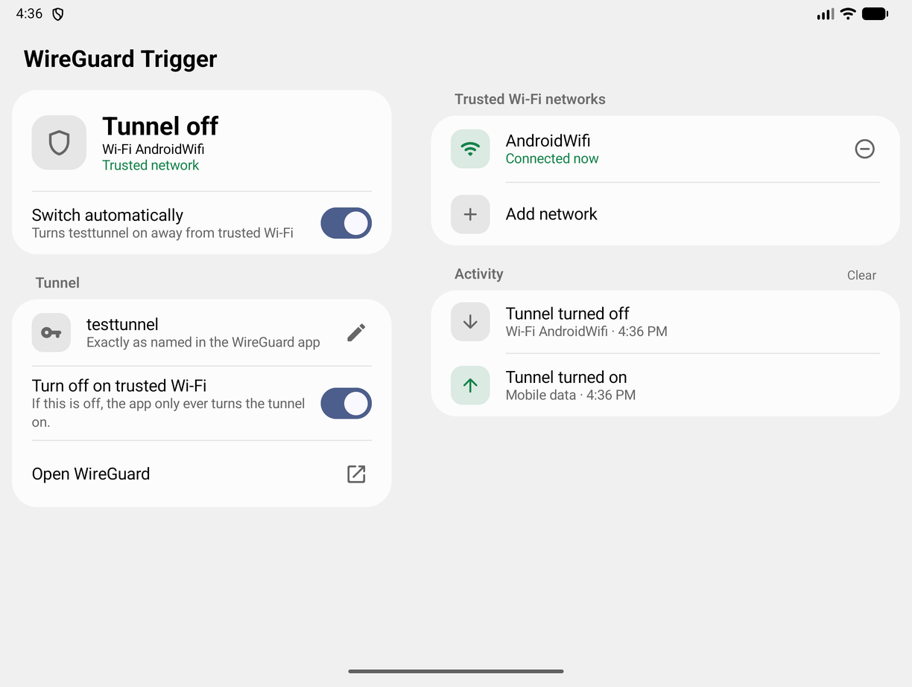
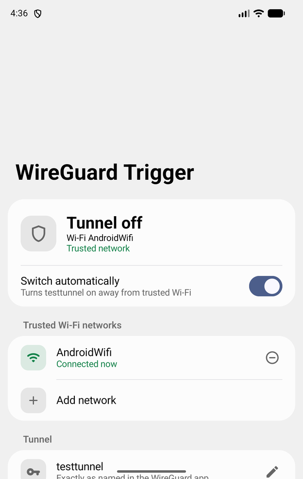

<div align="center">


# WireGuard Trigger

**Your WireGuard tunnel turns itself on when you leave your own Wi-Fi.**

WireGuard Trigger watches which network your phone is on. On a Wi-Fi network you trust, it turns the tunnel off. Anywhere else, it turns the tunnel on. You set it up once and then don't think about it. The official [WireGuard app](https://www.wireguard.com/install/) still runs the tunnel; this app only switches it. It's styled after Samsung One UI 9 and built for foldables like the Galaxy Z Fold8.

[](https://github.com/JustBuddy/wireguard-trigger/releases/latest)


</div>

## ✨ Features

- **Set up and forget.** After setup the app stays out of sight. It shows no notification, restarts after a reboot or an update, and only acts when the network changes.
- **Simple rules.**
  - On a trusted Wi-Fi network, the tunnel goes off. You can turn this off if you only want the app to switch the tunnel on.
  - On any other Wi-Fi, mobile data or Ethernet, the tunnel goes on.
  - If Android hides the Wi-Fi name, the network counts as untrusted, so the tunnel goes on.
  - With no connection at all, nothing changes.
- **Leaves manual switching alone.** A command is only sent when the network changes what the tunnel should be. If you switch the tunnel by hand, the app leaves it that way until you move to another kind of network.
- **Rides out hand-overs.** Changes have to hold for two seconds before the app acts, so roaming between access points or the gap before mobile data takes over doesn't toggle the tunnel.
- **Guided setup.** Every permission and setting the app needs is a step with a button that opens the right screen. A step disappears once it's done. A built-in test checks that WireGuard accepts commands.
- **Activity list.** Shows when the tunnel was switched and on which network, and records when WireGuard didn't react.
- **Made for foldables.** The cover screen shows one column. Unfolded, the status and tunnel settings sit on one side of the hinge, and the networks and activity on the other.
- **Light and dark, English and German.**

## 📸 Screenshots

| Unfolded | Folded (cover screen) |
|:---:|:---:|
|  |  |

<sub>Taken on the Android emulator set up as a Galaxy Z Fold8, with a test tunnel.</sub>

## 📥 Install and set up

1. Install the official [WireGuard app](https://play.google.com/store/apps/details?id=com.wireguard.android) and add your tunnel there.
2. Download `WireGuardTrigger-<version>.apk` from the [latest release](https://github.com/JustBuddy/wireguard-trigger/releases/latest) and open it on your phone. If Android asks, allow your browser or file manager to install apps.
3. Open WireGuard Trigger and work through the setup steps:
   - Allow tunnel control.
   - In WireGuard's App info, open *Battery* and choose *Unrestricted*. Android blocks background apps from starting services. Without this, WireGuard receives the command to turn the tunnel on but can't start its VPN.
   - Allow location *all the time* and keep location turned on. Android only tells apps the Wi-Fi name with this permission. The app never asks where you are.
   - In WireGuard's settings, turn on *Allow remote control apps*. Then tap *Test*.
4. Enter the tunnel name exactly as it appears in WireGuard, add your home Wi-Fi as a trusted network and turn on *Switch automatically*.

> [!TIP]
> Also set WireGuard Trigger's own battery use to *Unrestricted* (the app suggests it). One UI puts apps it thinks are unused to sleep.

You need Android 12 or newer. The app is built and tested on a Galaxy Z Fold8 with One UI 9, but it runs on any Android phone, and the layout adapts to the screen.

## 🔑 Permissions

| Permission | What it's for |
|---|---|
| `com.wireguard.android.permission.CONTROL_TUNNELS` | Telling WireGuard to bring the tunnel up or down |
| `ACCESS_FINE_LOCATION`, `ACCESS_COARSE_LOCATION` | Android only reveals the Wi-Fi name (SSID) to apps with precise location. The app never requests a location fix. |
| `ACCESS_BACKGROUND_LOCATION` | Reading the Wi-Fi name while the app is closed |
| `ACCESS_NETWORK_STATE`, `ACCESS_WIFI_STATE` | Watching which networks are connected and whether a VPN is up |
| `FOREGROUND_SERVICE`, `FOREGROUND_SERVICE_SPECIAL_USE` | Keeping the network watcher running in the background |
| `RECEIVE_BOOT_COMPLETED` | Starting it again after a reboot |
| `REQUEST_IGNORE_BATTERY_OPTIMIZATIONS` | Offering the one-tap *Unrestricted* battery dialog |

The app doesn't ask for notification permission, so Android keeps its background service out of the notification shade. It only shows up in the system's list of active apps.

## ⚙️ How it works

WireGuard for Android accepts `com.wireguard.android.action.SET_TUNNEL_UP` and `SET_TUNNEL_DOWN` broadcasts with the tunnel name, from apps that hold its `CONTROL_TUNNELS` permission, once *Allow remote control apps* is on. Tasker uses the same interface. WireGuard doesn't reply, so the app watches Android's VPN state to see whether a command worked.

A foreground service listens for network callbacks: one for physical networks (with the Wi-Fi name) and one for VPNs. It doesn't poll, so it does no work while the network stays the same.

## 🛠️ Build from source

You'll need the Android SDK (API 37) and JDK 17 or newer. Android Studio's bundled JBR works.

```sh
./gradlew assembleRelease        # app/build/outputs/apk/release/app-release.apk
./gradlew testDebugUnitTest      # unit tests
./gradlew lintDebug
adb install -r app/build/outputs/apk/release/app-release.apk
```

<details>
<summary><b>Signing and publishing releases</b> (for maintainers)</summary>

### Signing

Release builds are signed with the key named in `keystore.properties` next to `settings.gradle.kts`. That file is gitignored.

```properties
storeFile=C:/Users/you/.android/wireguardtrigger-release.jks
storePassword=…
keyAlias=wireguardtrigger
keyPassword=…
```

CI reads the same values from `SIGNING_*` environment variables. If neither is set, release builds fall back to the debug key and Gradle prints a warning. Android won't install a debug-signed copy over a release-signed one, or the other way round. Keep a backup of the keystore, because updates only install over a copy signed with the same key.

### Releases

The version lives in `gradle.properties` (`wireguardtrigger.version`), and the version code is derived from it. To publish a release:

1. Bump `wireguardtrigger.version` and merge.
2. Tag the merge commit `v<version>` and push the tag, for example `git tag v0.2.0 && git push origin v0.2.0`.

The [Release APK](.github/workflows/release.yml) workflow runs the unit tests and lint, builds the signed APK and attaches `WireGuardTrigger-<version>.apk` to a GitHub release for the tag. It fails if the tag and `wireguardtrigger.version` don't match. Pull requests run the same build and keep the APK as a run artifact. Only the job that publishes the release can write to the repository.

The workflow needs these repository secrets: `SIGNING_KEYSTORE_BASE64` (the keystore, base64-encoded), `SIGNING_STORE_PASSWORD`, `SIGNING_KEY_ALIAS` and `SIGNING_KEY_PASSWORD`.

</details>

## 🧱 Built with

- [Kotlin](https://kotlinlang.org/) and [Jetpack Compose](https://developer.android.com/compose), with a custom One UI theme on top of Material 3
- The [WireGuard Android app](https://git.zx2c4.com/wireguard-android/about/)'s remote-control broadcasts
- [AndroidX Window](https://developer.android.com/jetpack/androidx/releases/window) for the hinge

<sub>WireGuard is a registered trademark of Jason A. Donenfeld. This app is not affiliated with the WireGuard project.</sub>

---

<div align="center">
<sub>Created in <a href="https://t3.codes">T3 Code</a>.</sub>
</div>
